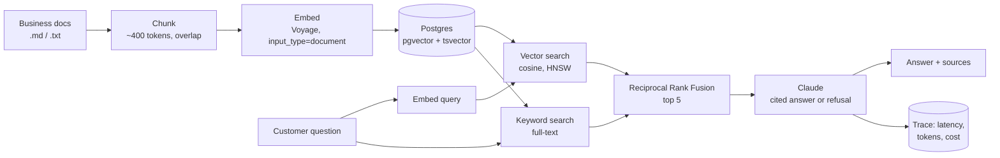

# Sidekick

A RAG customer assistant for small businesses. It answers customer questions only from the business's own documents (price lists, FAQs, policies), cites its sources, and refuses when the answer isn't there. Every request is traced for latency, tokens and cost, and an eval suite measures retrieval and answer quality.

Built in TypeScript with the Claude API, Voyage embeddings, Postgres + pgvector, and Langfuse.

## Architecture



## Results

Eval set: `evals/dataset.jsonl` (answerable and deliberately unanswerable questions).

| Run | recall@5 | Faithfulness | Correctness | Refusal accuracy | Avg latency | Cost / 1k questions |
| --- | --- | --- | --- | --- | --- | --- |
| Vector only | | | | | | |
| Hybrid (vector + keyword) | | | | | | |
| Hybrid, Sonnet | | | | | | |
| Hybrid, prompt caching | | | | | | |

*(Fill from `npm run eval` output. These numbers are the headline of this repo.)*

## Run it

```bash
cp .env.example .env          # add ANTHROPIC_API_KEY and VOYAGE_API_KEY
npm install
npm run db:up                 # Postgres + pgvector in Docker
npm run db:schema
npm run ingest                # chunk, embed and store data/sample-bakery
npm run ask -- "Do you deliver on Sunday?"
npm run dev                   # chat UI on http://localhost:3000
npm run eval                  # metrics table + evals/results/*.json
```

`GET /api/stats` returns request count, average and p95 latency, total and average cost, refusal rate and cached tokens.

## Design decisions

- **Hybrid retrieval with RRF.** Embeddings catch meaning ("can I pay by phone?" → SnapScan); keyword search catches exact terms (product names, "R550"). Reciprocal Rank Fusion merges the two by rank, so their incomparable raw scores never need normalising.
- **Separate embedding input types.** Documents and queries are embedded with different `input_type` values, which improves retrieval for asymmetric search.
- **Refuse rather than guess.** The model answers only from numbered excerpts, must cite them, and returns a fixed refusal string when the answer isn't there. Refusal accuracy is an eval metric.
- **Cost is a first-class metric.** Every request stores token usage including cache reads and writes, and cost is computed from configured prices.
- **Judge with a stronger model.** Faithfulness and correctness are graded by a larger Claude model than the one answering, with hand spot-checks of its verdicts.

## Weekend build plan

### Saturday
- [ ] Get keys: Anthropic, Voyage. `npm install`, `db:up`, `db:schema`, `ingest`, `ask` works end to end.
- [ ] Read `src/chunk.ts`, `src/retrieve.ts`, `src/generate.ts` and be able to explain each line.
- [ ] Inspect retrieval with `npm run ask`: see `vec=` and `kw=` ranks per chunk.
- [ ] Swap in a real small business's public info (with permission) or extend the bakery docs.
- [ ] Deploy to Cloud Run with a managed Postgres (Neon or Supabase both have pgvector).

### Sunday
- [ ] Grow `evals/dataset.jsonl` to 40 questions, about a quarter unanswerable.
- [ ] Run `npm run eval -- --mode vector` and `npm run eval` (hybrid). Record both in the table.
- [ ] Hand-check 10 judge verdicts; note any disagreement in the README.
- [ ] Experiment: chunk size 200 / 400 / 800, record recall@5.
- [ ] Langfuse: add tracing in `src/obs/trace.ts` (see the TODO there).
- [ ] Prompt caching: caching only applies once the cached prefix passes the model's minimum length. Move a long, stable business profile into the system prompt, then compare `cache_read_tokens` and cost before and after.
- [ ] Compare Haiku and Sonnet: quality versus cost per 1,000 questions.
- [ ] Fill the results table and pin the repo on GitHub.

## Interview notes (know these cold)

- **Why chunk at all?** Embeddings of long text average out meaning, and the context window has a cost. Smaller chunks retrieve precisely but lose surrounding context; overlap softens boundaries.
- **Cosine distance and HNSW.** `<=>` is cosine distance in pgvector. HNSW is an approximate nearest-neighbour graph index: fast, slightly lossy, tunable.
- **Why hybrid?** Pure vector search misses exact tokens; pure keyword search misses paraphrases.
- **What would you add next?** A reranker over the top 20, query rewriting for follow-up questions, per-tenant isolation, and online feedback (thumbs up/down) feeding the eval set.
- **How do you know it works?** The eval table, not vibes: recall@5 for retrieval, faithfulness and refusal accuracy for generation, cost and latency for production fitness.
