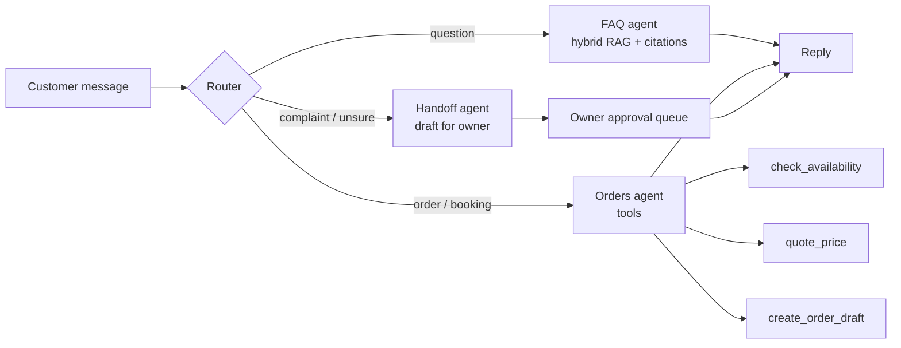

# Sidekick — Project Spec

An AI "digital staff member" for South African small businesses. It answers customer questions from the business's own documents, takes orders and bookings through tools, and hands anything uncertain to the owner for approval. It runs for one real pilot business, and every claim in the README is backed by a measured number.

## Portfolio checklist → how Sidekick covers it

| Checklist item | Covered by | Proof in the repo |
| --- | --- | --- |
| 1–3 polished, end-to-end projects | One project, built end to end: ingestion → agents → UI → deployment → monitoring | Live URL, 2-minute demo video, README |
| Real RAG system + real corpus | Hybrid RAG over a real pilot business's documents | `data/<business>/` (with owner consent), ingestion logs |
| Real eval set + quantitative metrics | Eval suites per component plus end to end, built from real customer questions | `evals/`, results table |
| Live and solving a real problem | Deployed on Cloud Run; one business uses it for a pilot week | Pilot metrics: questions handled without the owner |
| Multi-agent workflow someone would pay for | Router → FAQ agent / Orders agent / Handoff agent | Architecture diagram, agent evals |
| Fine-tune with a clear reason + baseline | Fine-tuned router vs prompted-Haiku baseline | `finetune/` report with accuracy, cost, latency |
| Honest comparison + real purpose | Vector vs hybrid; Haiku vs Sonnet; prompted vs fine-tuned router | Comparison tables, including losses |
| Explain your trade-offs | "Design decisions" and "Limitations" sections | README |
| Show production instincts | Retries, fallbacks, idempotency, spend caps, PII handling, CI evals | Code, `/api/stats`, alerts |
| Error handling, evaluation, deployment, cost monitoring | See "Production" below | Each has a section and a metric |
| Quantify results, not vague improvements | Every README claim has a number, n, and how it was measured | Results tables |

## The real problem

Small businesses lose sales because customer messages (prices, hours, "can you do a cake for Saturday?") arrive while the owner is busy. Sidekick answers the routine ones instantly, captures orders, and only interrupts the owner when it matters.

**Pilot business:** one real SA small business (bakery, butcher, car wash or similar), with the owner's written consent.

**Corpus:** price list, FAQ, opening hours, policies, menu or service list, and a sample of past customer messages.

**POPIA:** customer messages are anonymised before storage or use in evals: names, phone numbers and addresses replaced with placeholders. Only the owner's business documents are stored as-is.

## Architecture

- **Router:** classifies each message into `faq`, `order`, `handoff` or `smalltalk`. Starts as a prompted Haiku call with structured output; later replaced or backed by the fine-tuned model if it wins on the comparison.
- **FAQ agent:** the existing hybrid RAG pipeline (vector + keyword, RRF), citations, fixed refusal.
- **Orders agent:** multi-turn, tool-calling. It collects the order details, checks availability against the business's rules (lead times, closed days), quotes the price from the price list (never invents one), and creates an order draft that the owner confirms.
- **Handoff agent:** for complaints, refunds, anything outside policy, or low confidence. It drafts a reply and puts it in the owner's approval queue; nothing is sent without approval.
- **Orchestration in code, not a free-roaming agent.** The router decides; each agent has a narrow toolset. Conversation state is stored per conversation ID.
- **Channel:** web chat widget first. WhatsApp (Meta Cloud API) is a stretch goal, because it needs Meta business verification.

## Evals

Built from real (anonymised) customer messages, plus written edge cases. Each suite has a fixed test set and reports n.

| Component | Metrics |
| --- | --- |
| Router | Accuracy, macro-F1, confusion matrix |
| FAQ (RAG) | recall@5, faithfulness, correctness, refusal accuracy |
| Orders agent | Task success on scripted multi-turn conversations, tool-call correctness, invented-price rate (target 0) |
| Handoff | Escalation precision and recall (should escalate vs did escalate) |
| End to end | Conversation-level success on 20 full scripted conversations |
| Safety | Prompt-injection suite: injected instructions in messages and documents; pass rate |

- LLM-as-judge (stronger model) where needed; 10% of verdicts hand-checked, agreement rate reported.
- Evals run in CI on every PR that touches prompts, retrieval or agents; a regression beyond a set threshold fails the build.
- Prompts are versioned files; results are tagged with the prompt version.

## Fine-tune: the router

**Clear reason:** the router runs on every message, so it dominates call volume. A small fine-tuned classifier could match the prompted model's accuracy at a fraction of the cost and latency.

- **Data:** at least 300 labelled real messages from the pilot (anonymised), split 80/20 into train and test, stratified by label. The test set is locked before training and never used for tuning.
- **Baseline:** the best prompted router: Haiku with a tuned prompt, few-shot examples and structured output, on the same test set.
- **Candidate:** a small open model fine-tuned for classification (choose the service when we get there).
- **Compare:** accuracy, macro-F1, cost per 1,000 messages, p95 latency.
- **Decision rule, fixed in advance:** ship the fine-tuned router only if it's within 2 points of baseline accuracy and at least 5× cheaper. Otherwise keep the baseline and publish the result anyway.

### It must be a real fine-tune

"Fine-tuning" means updating a model's weights on our training data. Prompt engineering, few-shot examples, RAG and system prompts are not fine-tuning, and the repo never calls them that. The `finetune/` folder publishes proof:

- The base model name and version
- The training data format and size (labels and counts, anonymised samples)
- The training configuration: method (full or LoRA/QLoRA), epochs, learning rate, and the service or hardware used
- The training and validation loss curves
- The resulting model ID or weights location
- The training cost and time
- The evaluation script that scores baseline and fine-tuned on the identical locked test set

## Honest comparisons: every result has a baseline

No number is reported without the baseline it beat. The baseline is always the **best current alternative**, not a weak strawman.

| Claim | Baseline (best current alternative) | Why this baseline |
| --- | --- | --- |
| Sidekick is useful to the business | The owner answering messages manually (pilot week before go-live): response time, % of messages answered within 1 hour | That's what the business does today |
| RAG answers well | **Long-context stuffing:** the whole corpus in one prompt, no retrieval | A small business's documents may fit in context; RAG has to beat that on quality or cost to justify itself |
| Hybrid retrieval helps | Vector-only and keyword-only (BM25) retrieval | Standard alternatives |
| Multi-agent design helps | **One agent with all the tools** and one prompt | The simpler design; the router and specialists must earn their complexity |
| Fine-tuned router helps | **Best prompted router:** Haiku with a tuned prompt and few-shot examples | The fine-tune must beat a strong prompt, not a lazy one |
| Model choice | Haiku vs Sonnet on the same evals | Quality vs cost trade-off |
| Prompt caching helps | Same traffic without caching | Direct before/after |

Each comparison reports n, the metric definition, both numbers, and the delta. Results where the simpler baseline won are published, and the design changes to match.

## Production

- **Error handling:** timeouts on every model and embedding call; retries with exponential backoff and jitter on 429/5xx; fallback to a second model if the primary keeps failing; graceful "the owner will get back to you" reply instead of an error page.
- **Idempotency:** order creation keyed by conversation and an idempotency key, so retries never create duplicate orders.
- **Input safety:** length limits, rate limiting per conversation, prompt-injection defences (data delimited, tools least-privilege), output validated with Zod before any tool call or reply.
- **Cost monitoring:** tokens and cost per request, per conversation and per business per day; daily spend cap per business with an alert at 80%; prompt caching on stable prefixes.
- **Observability:** Langfuse traces (one trace per message, spans per agent and tool call); `/api/stats` for request volume, p50/p95 latency, cost, refusal and escalation rates.
- **Deployment:** Cloud Run + managed Postgres with pgvector (Neon or Supabase); secrets in Secret Manager; health check endpoint; deploy from CI.
- **Privacy:** POPIA anonymisation before storage; no customer PII in logs or traces.

## README results (fill only from real runs)

| Result | Value | n | How measured |
| --- | --- | --- | --- |
| Retrieval recall@5 (hybrid vs vector) | | | `npm run eval` |
| Answer faithfulness | | | Judge + hand-check |
| Refusal accuracy | | | Unanswerable subset |
| Router accuracy (prompted vs fine-tuned) | | | Router test set |
| Orders task success / invented-price rate | | | Scripted conversations |
| Escalation precision / recall | | | Handoff suite |
| Injection suite pass rate | | | Safety suite |
| p95 latency | | | `/api/stats`, pilot week |
| Cost per 1,000 conversations | | | Traces |
| Pilot: questions handled without the owner | | | Pilot week logs |

## Build workflow (every phase follows this)

1. **Product idea:** the phase's goal, stated as a problem for the pilot business.
2. **Ground truth set + baseline first.** Write the labelled test set and run the best-current-alternative baseline *before* building the new approach. The target is known before any code.
3. **Choose 2 approaches to compare,** e.g. hybrid RAG vs long-context stuffing, or Haiku vs Sonnet.
4. **Build end to end:** data → pipeline → app, the thinnest working slice first.
5. **Review as you go:** every change goes through a branch and a pull request, never straight to `main`. PRs get an AI review (Claude or CodeRabbit) plus your own read before merging.
6. **Run the quantitative eval:** approach A vs approach B vs baseline, on the same locked test set.
7. **Justify the final choice:** accuracy vs cost vs latency, written as a short decision record (`docs/decisions/NNN-title.md`: context, options, results table, decision, trade-off accepted).
8. **Write tests:** unit tests for the deterministic parts (chunker, rank fusion, cost calculation, input validation, idempotency, tool argument validation) plus integration tests for the pipeline with model calls mocked. Evals measure quality; tests catch breakage. Tests run in CI on every PR.
9. **Push clean history:** small, descriptive commits; one PR per change, with a description linking to its eval results.
10. **README explains every decision,** linking to the decision records.
11. **Ready to showcase:** you can walk an interviewer from problem to baseline to comparison to decision to trade-off.

## Phases

| Phase | When | Deliverables | Checklist items covered |
| --- | --- | --- | --- |
| 1. Real RAG, live | This weekend | **First:** FAQ ground-truth set from real customer questions + long-context baseline run. **Then:** real corpus ingested, hybrid RAG vs long-context compared, decision record, unit tests + CI, deployed, cost tracking, error handling | Real RAG + corpus, eval set, baseline, deployment, cost monitoring, error handling |
| 2. Agents | Week 2 | Router, Orders and Handoff agents, owner approval queue, agent and safety evals, CI evals | Multi-agent workflow, production instincts |
| 3. Pilot | Week 3 | One week live with the business; collect labelled routing data; pilot metrics | Live and solving a real problem, quantified results |
| 4. Fine-tune and write-up | Week 4 | Router fine-tune vs baseline, all comparisons, trade-offs, limitations, demo video | Fine-tune + baseline, honest comparison, trade-offs, polish |

## Definition of done

- [ ] Live URL works for a stranger
- [ ] Every row in the results table filled from a real run, with n
- [ ] At least one comparison where the "fancier" option lost, reported honestly
- [ ] **No baseline, no claim:** every number in the README names the best-current-alternative baseline it was measured against
- [ ] **No fake fine-tuning:** the fine-tune has published weights or model ID, config, loss curves and a locked test set; nothing prompt-based is called fine-tuning
- [ ] Design decisions and limitations written, with a decision record for every major choice
- [ ] Unit and integration tests pass in CI; evals run on PRs that touch prompts, retrieval or agents
- [ ] All work merged through reviewed PRs with clean commit history
- [ ] Demo video (2 minutes) in the README
- [ ] The pilot business owner would say it saved them time
